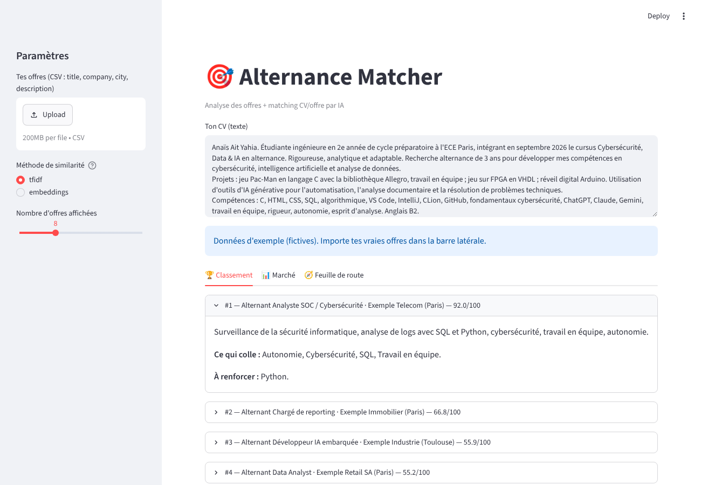

# 🎯 Alternance Matcher

Outil personnel qui **analyse des offres d'alternance** (Data / IA) et **classe celles qui correspondent le mieux à mon CV**, avec une explication pour chaque offre.

Construit pour ma vraie recherche d'alternance : je l'utilise tous les jours.



*Capture réalisée avec les offres d'exemple fictives incluses dans `data/`.*

## Ce que ça fait
1. **Data** : charge un CSV d'offres, nettoie (doublons, valeurs vides) et extrait les compétences demandées (pandas + regex).
2. **Analyse** : quelles compétences reviennent le plus, dans quelles villes, et lesquelles il me manque (« skill gap »).
3. **IA / matching** : similarité sémantique CV ↔ offre (TF-IDF ou embeddings multilingues) combinée à la couverture des compétences.
4. **LLM** : explication personnalisée en français (pourquoi ça colle, ce qui manque, conseil pour la lettre de motivation) via l'API Claude, avec repli sans API.
5. **Interface** : app Streamlit (classement, marché, feuille de route).

## Lancer
```bash
pip install -r requirements.txt
streamlit run app.py
```
Options : `pip install sentence-transformers` (méthode « embeddings ») et `pip install anthropic` + `export ANTHROPIC_API_KEY=...` (explications LLM).

Remplace `data/offers_sample.csv` (offres **fictives**) par tes offres : colonnes `title, company, city, description`.

## Structure
```
app.py            interface Streamlit
src/clean.py      chargement + nettoyage
src/skills.py     dictionnaire de compétences + extraction
src/analyze.py    fréquences, skill gap
src/match.py      similarité + score final (60 % texte / 40 % compétences)
src/explain.py    explication (règles ou LLM)
tests/            test de bout en bout
```

## Limites connues (et pistes)
- L'extraction de compétences repose sur un dictionnaire : à enrichir ou remplacer par un modèle NER.
- Le score est heuristique (60/40 choisi à la main) : piste = le calibrer avec mes propres retours (offres qui m'ont plu / non).
- Pas encore de collecte automatique : piste = API d'un job board.
